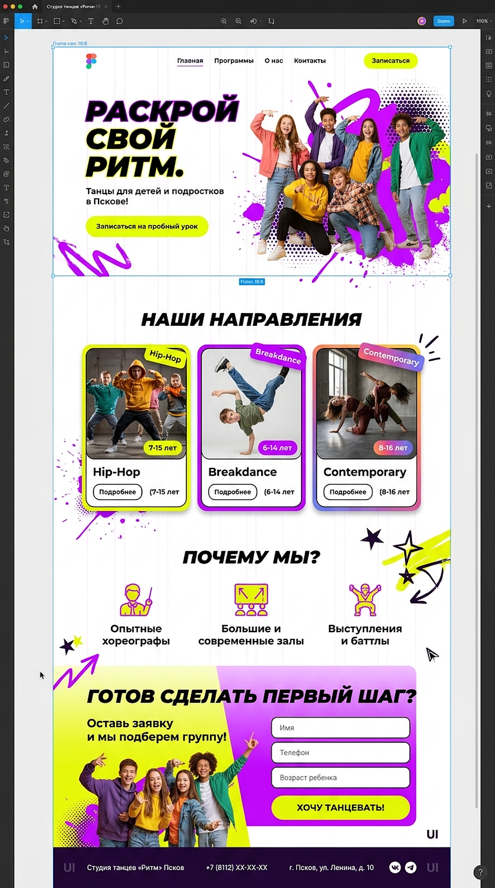
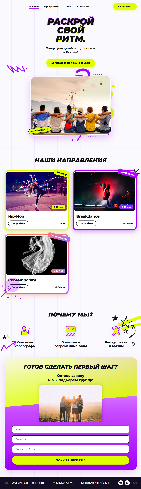

# ⚡ Студия танцев «Ритм» (Псков) — Лендинг

Адаптивная верстка яркого промо-лендинга для детской и подростковой студии современного танца. Проект реализован в рамках полного цикла frontend-разработки: от переноса дизайн-токенов из Figma до семантической верстки, интерактивной логики и публикации.

---

## 🔗 Ссылки на проект
* 🚀 **Рабочий сайт (GitHub Pages):** [Смотреть демо в браузере](https://luckyalmz.github.io/luckyalmz/)
* 🎨 **Дизайн-макет:** Разработан в Figma

---

## 📐 Сравнение: Макет vs Реализация

| Исходный макет (Figma) | Сверстанный сайт (Код) |
| :---: | :---: |
|  |  |

---

## 🛠 Стек технологий и решения
* **HTML5:** семантическая структура тегов (`header`, `section`, `article`, `footer`), доступные формы и кнопки.
* **CSS3:** 
  * Адаптивная верстка с применением CSS Grid и Flexbox.
  * CSS Variables (кастомная цветовая палитра, неоновые акценты, фоновая сетка).
  * Сложная векторная графика: граффити-фон, полутоновые точки (halftone pattern), стилизованные тени и декоративные бейджи.
* **JavaScript (Vanilla):**
  * Мобильное меню с плавной навигацией по якорным ссылкам.
  * Интерактивное модальное окно с детальным расписанием и описанием направлений танцев.
  * Валидация и маска для ввода телефонного номера в форме заявки.
  * Всплывающие уведомления (Toast) при отправке формы.

---

## 📱 Адаптивность
Интерфейс оптимизирован под различные типы экранов:
* 🖥 Десктопные мониторы (1200px+)
* 💻 Ноутбуки и планшеты (768px – 1024px)
* 📱 Смартфоны (до 768px)
